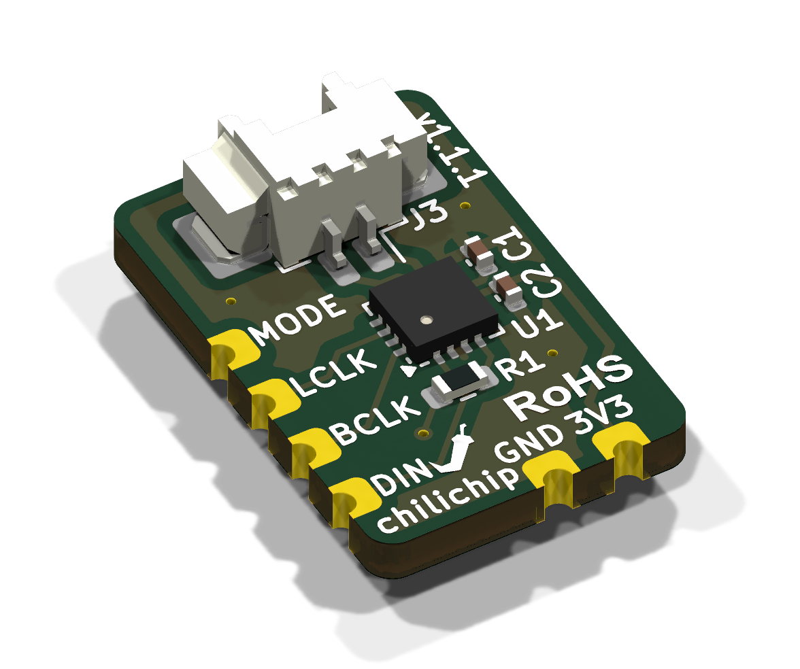
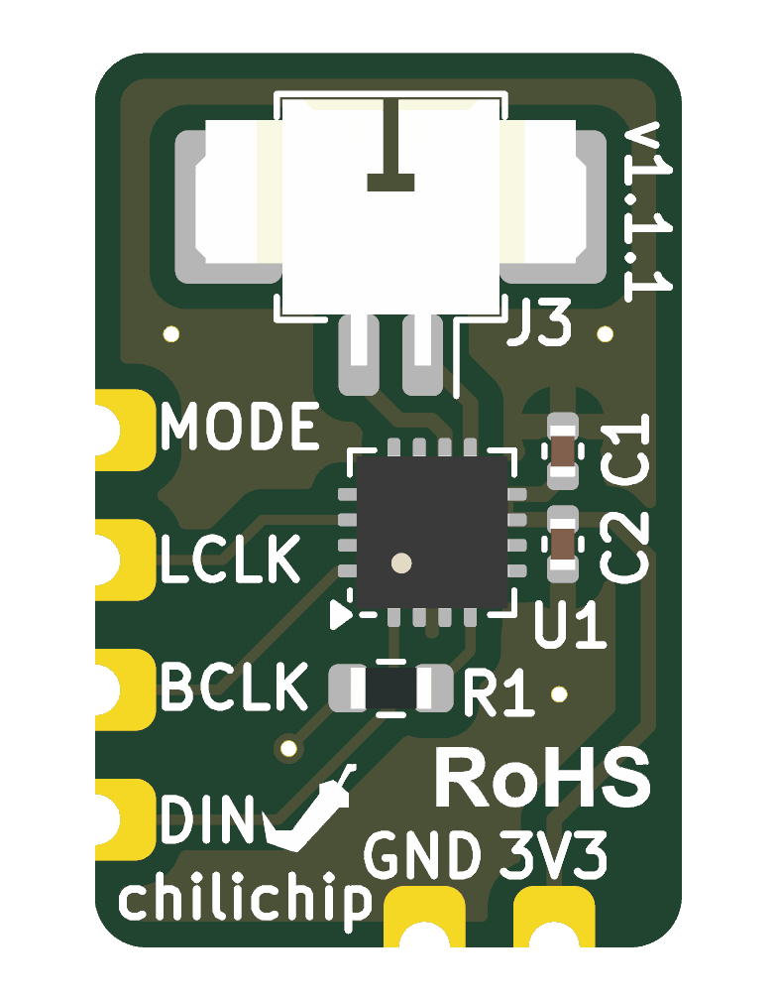
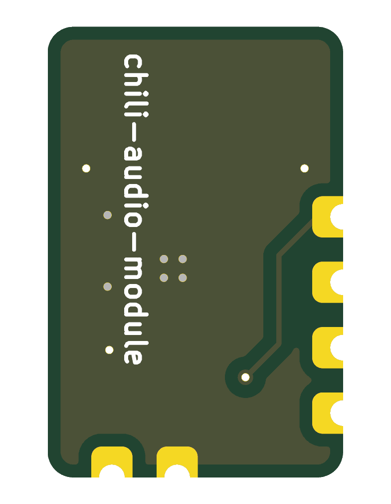

# chili-audio-module

KiCad 10 project for the **chilichip audio module**: a tiny I²S mono speaker amplifier based on the [MAX98357A](https://www.analog.com/media/en/technical-documentation/data-sheets/MAX98357A-MAX98357B.pdf), made to be soldered flat onto a host board through castellated edge pads. It is the audio board for [chilichip](https://chilichip.eu)'s [VGC Zero](https://github.com/chili-chip/vgc-zero-hardware) game console, and works with any 3.3 V microcontroller that can output I²S (RP2040/RP2350, ESP32, …).

Current revision: **v1.1.1**

  

| Top | Bottom |
|:---:|:---:|
|  |  |

## Specifications

| | |
|---|---|
| Amplifier | MAX98357A: I²S in, filterless class D out, no MCLK needed |
| Gain | 12 dB (GAIN_SLOT tied to GND) |
| Channel | Mono (L+R)/2 mix when MODE is driven at 3.3 V |
| Supply | 3.3 V |
| Speaker output | Molex PicoBlade 1.25 mm 2-pin connector (J3), for a 4–8 Ω speaker |
| Board | 11.5 × 17.5 mm, 2 layers, 1.6 mm, all parts on the top side |
| Host connection | 6 castellated half-holes, 2.54 mm pitch |

The speaker output is bridge-tied (OUTP/OUTN). Connect the speaker across the two connector pins, and don't tie either one to ground.

## Pinout

Seen from the top, with the speaker connector at the top edge. Positions are pad centres, measured from the board's bottom-left corner.

| Pad | Signal | Edge | Position | Description |
|-----|--------|------|----------|-------------|
| J1.4 | MODE | left | y = 10.12 mm | Enable. High (3.3 V) = on, mono mix. Low = shutdown. Goes to SD_MODE through R1 (510 kΩ) |
| J1.3 | LRCLK | left | y = 7.58 mm | I²S word select (labelled LCLK on the silkscreen) |
| J1.2 | BCLK | left | y = 5.04 mm | I²S bit clock |
| J1.1 | DIN | left | y = 2.50 mm | I²S data |
| J2.2 | GND | bottom | x = 6.46 mm | Ground |
| J2.1 | 3V3 | bottom | x = 9.00 mm | 3.3 V supply |

The amplifier accepts standard I²S, left-justified and TDM audio. Drive MODE from a GPIO to switch the amplifier off when idle, or tie it to 3V3 to keep it always on.

## Bill of materials

| Ref | Part | Package | LCSC |
|-----|------|---------|------|
| U1 | MAX98357AETE+T | TQFN-16 3 × 3 mm | [C910544](https://www.lcsc.com/product-detail/C910544.html) |
| J3 | Molex 53261-0271, PicoBlade 2-pin, right angle | SMD | [C177225](https://www.lcsc.com/product-detail/C177225.html) |
| C1 | 10 µF, 6.3 V, X5R | 0402 | [C15525](https://www.lcsc.com/product-detail/C15525.html) |
| C2 | 100 nF, 16 V, X7R | 0402 | [C1525](https://www.lcsc.com/product-detail/C1525.html) |
| R1 | 510 kΩ, 1 % | 0603 | [C23192](https://www.lcsc.com/product-detail/C23192.html) |

J1 and J2 are the castellated edge pads, which are part of the board itself, so there's nothing to buy or place for them.

## Ordering from JLCPCB

Every tagged release has the files JLCPCB needs attached, for both bare PCBs and assembled boards:

- `chili-audio-module-<version>-gerbers.zip`: Gerbers and drill file
- `chili-audio-module-<version>-bom.csv`: bill of materials with LCSC part numbers
- `chili-audio-module-<version>-cpl.csv`: component placement list

1. Download the three files from the [latest release](https://github.com/chili-chip/chili-audio-module-hardware/releases/latest).
2. On [jlcpcb.com](https://jlcpcb.com/), click **Order now** and upload the gerber zip.
3. Set the PCB options:
   - Layers: **2**
   - PCB thickness: **1.6 mm**
   - **Castellated Holes: Yes** (required, because the module's pads are plated half-holes)
   - Surface finish: **ENIG** recommended, for the flat QFN pads and castellations. HASL also works.
   - Everything else can stay at the defaults.
4. For assembled boards, turn on **PCB Assembly**, choose **Top side** assembly, and click **Next**. If the Economic assembly option isn't available together with castellated holes, choose Standard.
5. Upload the BOM and CPL files and check that all five parts (C1, C2, J3, R1, U1) are matched and in stock. The MAX98357A and the connector are usually "extended" parts, which add a small one-off fee each.
6. In the part placement preview, check that:
   - **U1**'s pin 1 dot is in the bottom-left corner, next to the triangle on the silkscreen. Rotate it in the preview if not.
   - **J3**'s opening faces the top edge of the board, with its two mounting tabs on the large pads.
7. Add to cart and place the order.

To build the files from a local checkout instead, run `scripts/export-jlcpcb.sh` (needs KiCad 10's `kicad-cli`, `zip` and `python3`). The files are written to `production/`.

## Using the module on a host board

- On the host board, place SMD pads matching the castellations: four along one edge at 2.54 mm pitch, and two along the adjacent edge. The positions are in the [pinout](#pinout) table.
- `chili-audio-module-hardware.step` is a 3D model of the assembled module, with its origin at the bottom-left corner of the board. Assign it to the host board's footprint with no offset, so the module sits flat on the host.
- Keep the host board free of tall parts under the module.

## Repository layout

| Path | Contents |
|------|----------|
| `chili-audio-module-hardware.kicad_*` | KiCad 10 schematic, PCB and project |
| `chili-audio-module.pretty/` | Project footprints (castellated edge pads) |
| `chili-audio-module-hardware.step` | 3D model of the assembled module |
| `scripts/export-jlcpcb.sh` | Builds the JLCPCB Gerber zip, BOM and CPL |
| `scripts/render-images.sh` | Regenerates the renders in `docs/images/` |
| `.github/workflows/main.yml` | CI and release workflow |

CI runs ERC, DRC and the JLCPCB export on every push and pull request. Pushing a `v*` tag publishes a GitHub release with the schematic PDF, a PCB image, Gerbers and the JLCPCB files.
